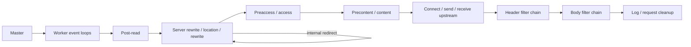
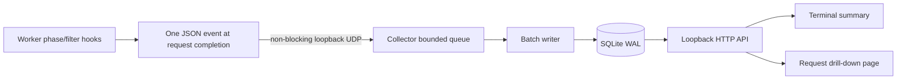

# Architecture

## nginx request processing

The master manages configuration and workers. Each worker multiplexes many
connections in an event loop. It advances a request while work is ready and
resumes it when socket or timer events arrive. A slow upstream should not stall
other connections. Keepalive lets a connection carry multiple requests; HTTP/2
also multiplexes streams. A request and a connection are different lifetimes.

Rewrite and access handlers may finish a request before content runs. Proxying is
a content handler with asynchronous upstream I/O. Filters transform output as it
flows through nginx. Buffering, compression, caching and retries affect what any
one hook sees. These extension points follow the
[nginx development guide](https://nginx.org/en/docs/dev/development_guide.html).

## Integration choices

Relative overhead below is a design assessment, not a benchmark.

| Option | Hook and visibility | Gaps | Cost / expected overhead |
| --- | --- | --- | --- |
| Native C dynamic module | Phase handlers, header/body filters, upstream state, TLS variables; direct access to internal redirects | Exact buffering state and every low-level upstream transition need further hooks or core instrumentation | Highest maintenance; compile for each nginx build; bounded native observation should be inexpensive |
| njs | `js_set` evaluates variables, `js_content` owns a content handler, `js_header_filter` / `js_body_filter` observe output; headers, body chunks and exposed variables | Content hook is not a transparent replacement for proxy_pass; no arbitrary core-phase tracing | Install compatible njs; JS execution and copies add cost; quicker iteration |
| OpenResty / Lua | Phase APIs, `log_by_lua`, `body_filter_by_lua`, headers and nginx variables | Not every internal event; phase restrictions apply to APIs such as sockets | Requires Lua module/LuaJIT or replacing nginx with OpenResty; strong ecosystem but larger deployment change |
| mirror | Background subrequest sends an original-request copy to a capture backend | Does not capture the original response body or a complete phase timeline; enabling mirrored bodies changes request buffering | Config-only if available; extra requests/body reads can be expensive |
| JSON access log + shipper | `log_format escape=json`, request/status/size/upstream/TLS variables | No output body and limited phase visibility; logs at completion | Lowest deployment cost; buffering reduces write frequency; disk/shipper backpressure needs management |
| eBPF / packet capture | Kernel/socket/TCP events and packet timing without an nginx module | TLS plaintext, headers and bodies need TLS/application hooks; mapping to internal phases is difficult; HTTP/2 correlation is harder | Privileged/kernel/version-specific tooling; capture volume and probe selection dominate cost |

References: [njs HTTP module](https://nginx.org/en/docs/http/ngx_http_js_module.html),
[Lua module](https://github.com/openresty/lua-nginx-module),
[mirror module](https://nginx.org/en/docs/http/ngx_http_mirror_module.html),
[access logs](https://nginx.org/en/docs/http/ngx_http_log_module.html).

Choose **native C** for learning nginx internals while keeping the deployed proxy.
Use **JSON access logs** as fallback when a matching module build cannot be
maintained. The prototype does not claim to capture everything nginx does.

## Data path

Capture is opt-in at runtime. An 8-byte file is mapped read-only once by each
nginx worker and writable by the collector. On Linux x86-64 its aligned 64-bit
monotonic deadline is published with one native store and read with one volatile
load. The collector renews a 1.5-second lease every 250 ms only while a manual or
timed session is active. It writes zero on stop/startup/shutdown. Workers reject
expired or implausibly distant deadlines before creating per-request state. The
control is checked again at log time: a request finishing after capture stops is
excluded. A collector crash causes the lease to expire without worker timers,
syscalls or a reload. Keep the control inode and clock namespace stable.

There is no disk I/O, DNS, retry or collector acknowledgement in a worker. Each
field is capped at 256 bytes; the JSON buffer is 8 KiB, and oversized events are
dropped atomically. Samples are selected once per main request. Per-request state
survives internal redirects in the request cleanup list. Subrequests are excluded.
The body filter counts buffer lengths without reading their contents, including
file-backed buffers. Filter-chain placement determines whether those byte counts
are before or after another transformation; `wire_bytes` is recorded separately.

There is no file open/read per request: only shared-memory reads. Missing control
mapping fails closed. The collector keeps history and its local control/view API
available while stopped. Control POSTs require bounded JSON, local Host, and a
matching Origin when supplied, to block cross-site requests and DNS rebinding.

The local receiver accepts at most 8 KiB and validates a closed schema before
enqueueing. A 10,000-event queue isolates SQLite writes from UDP ingestion. The
writer commits batches of up to 200 events. The database retains at most 100,000
events and 24 hours by default; cleanup runs during ingestion. WAL reuses pages;
deleted rows do not immediately shrink the file. API queries are bounded. No raw
event or HTTP request is written to collector logs. Shutdown drains queued events.

## Schema semantics

| Field | Meaning |
| --- | --- |
| `schema`, `id` | Schema version 1; worker PID, connection number, connection request counter, epoch start |
| `started_ms`, `duration_ms` | Epoch start milliseconds and elapsed milliseconds; phase timing uses nginx's monotonic clock |
| `phases_ms` | First observed post-read, rewrite, preaccess boundary, precontent boundary, header and body filter offsets; skipped/unobserved phases are null |
| `rewrite_visits` | Number of visits to the observer's rewrite handler, including internal redirects; not a complete redirect trace |
| `client`, `method`, `path` | Socket peer, method and final normalized path without query; no forwarded-client-header trust inference |
| `request_headers`, `response_headers` | Small allowlists; all other header names and values omitted |
| `request_bytes`, `response_body_bytes`, `wire_bytes` | nginx request length, observed filter-body size and nginx bytes-sent variable |
| `upstream` | Address and connect/header/response seconds, statuses and cache result; retry lists preserved as nginx strings |
| `tls` | Negotiated protocol and cipher, or null for plaintext |
| `worker_sent`, `worker_dropped` | Worker-local counters before this event's send; reset when workers restart |

Requests still in flight do not appear until completion. WebSockets and long SSE
streams can remain absent for a long time. Intermediate chunk timestamps,
temporary-file buffering, upstream keepalive reuse and full redirect history need
additional instrumentation. Future schema fields must distinguish observation
from inference.

## Safety, failure handling and decisions

Use an allowlist rather than a blacklist for headers. The explicit exclusion set
includes Authorization, Proxy-Authorization, Cookie, Set-Cookie, X-Api-Key and
token-like custom headers. Body capture is absent; queries are removed in both
emitter and collector. Paths still need route-level exclusion for secrets embedded
in path segments. Local datagrams are unauthenticated: another local process can
forge events, so this is not a security audit trail. Protect database access and
use SSH to reach the loopback UI. Do not mount production credentials into the
collector or add public nginx routes for the viewer.

Lost events must never block traffic. Kernel UDP drops cannot be inferred solely
from worker counters; use receive/write counts and controlled request-count tests.
Transport failures, queue saturation and storage failures have separate counters.
If reliable delivery becomes mandatory, use a bounded shared-memory ring with a
separate draining process and explicit loss accounting. Do not retry in workers.

Open decisions: acceptable sampling/retention and client-IP handling; whether
live in-flight stream inspection is required; PostgreSQL for multiple proxies;
whether body capture's security cost is acceptable; supported nginx builds and
automated compatibility testing; authenticated team access to the viewer.
